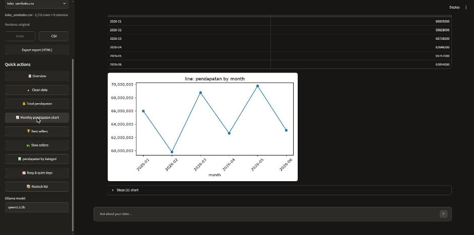
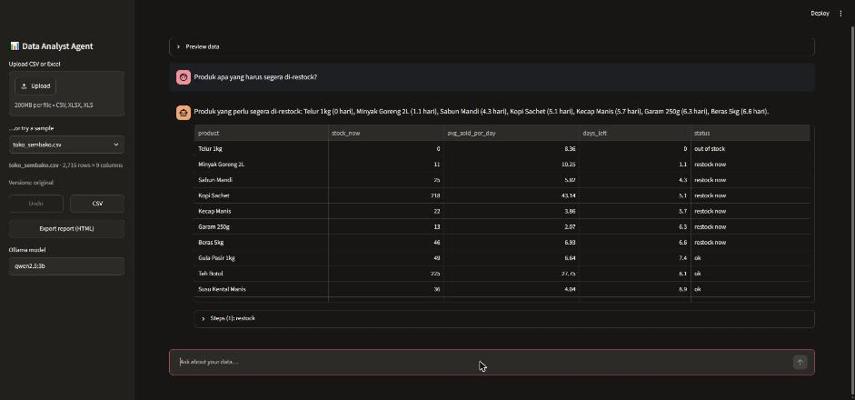
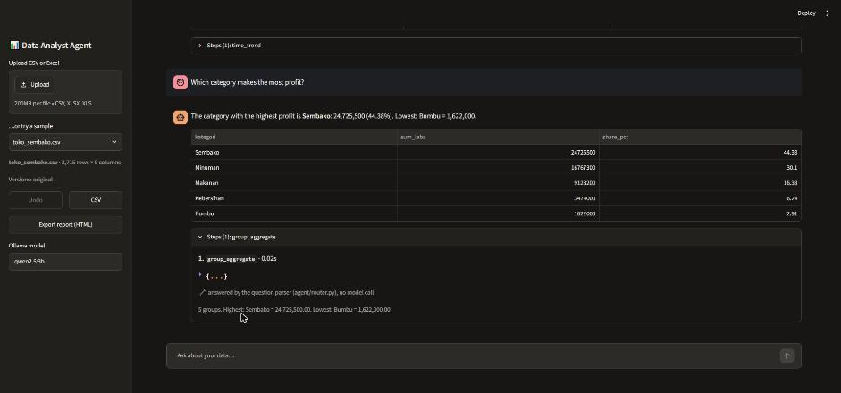

# 📊 Data Analyst Agent

An AI agent that does the everyday work of a data analyst on your CSV/Excel files — cleaning, summarising,
grouping, finding outliers, trends, forecasts and charts — answering questions in **English or Indonesian**.

It runs **100% offline on a normal laptop** (tested target: GTX 1650 4 GB / 16 GB RAM, and MacBook) using a
small local model through [Ollama](https://ollama.com). No API key, no data leaves your machine.

> *“Which city had the highest revenue in 2025?”* → **Jakarta, Rp 811.6 million (38.2% of total)** + table + bar chart + the steps it took.

## Why it works on a small model

Small models (3B parameters) are bad at writing long pandas code, but good at **choosing a tool and filling
in its arguments**. So the agent gets 18 tested analysis tools and only writes its own code as a last resort:

```
question ─► model picks a tool + arguments ─► tested pandas code runs ─► result back to model ─► answer
                     ▲                                   │
                     └──── error message (self-correct) ◄┘     (max 6 steps)
```

**Frequent questions skip the model.** Totals, counts, averages, "which X has the most/least Y", "which month /
which day", restock and "how much stock is left" are answered by a deterministic question parser
(`agent/router.py`): it matches the question against the data's own column names and values plus English and
Indonesian synonyms (*paling laris*, *pendapatan*, *bulan Maret 2026*…), runs the tested tool and writes the
answer from a template. Answered in ~0.04 s, nothing for the model to misread. It is strict on purpose: if
**any** word in the question is not understood (*"…employees who **left** the company"*), it hands the question
to the model unchanged. Steps panel: *"answered by the question parser"*.

```
question ─► parser understands every word? ── yes ─► tested tool ─► template answer
                         │ no
                         ▼
                   the model loop below
```

**No made-up numbers:** every number in the model's answer is checked against what the tools actually
returned (English and Indonesian number formats, "juta"/"miliar"/"billion"). If one doesn't match, the answer
is replaced by the tool's own verified summary, with a warning. Every answer also shows the table/chart it came from.

## In the browser

Tested in the real app (`streamlit run app.py`) on the `toko_sembako.csv` sample, 2026-11-19:

| Question | Answer | Path | Time |
|---|---|---|---|
| *Produk apa yang harus segera di-restock?* | 7 products: Telur 1kg (sold out), Minyak Goreng 2L (1.1 days), … | parser | 0.03 s |
| *Hari apa penjualan paling sepi?* | Tuesday (Selasa), −17.9% vs average | parser | instant |
| *Which category makes the most profit?* | Sembako, 24,725,500 (44.38%) | parser | 0.02 s |
| *Show the monthly revenue trend as a line chart* | **Line chart** by month + table (peak May, 69,767,000) | parser | instant |

The chart question first went to the model, which returned the right numbers as a table but no chart. Fixed:
the parser now handles chart requests ("monthly / weekly / daily trend", "*grafik penjualan mingguan*", "revenue
by city"), the chart tool groups by `month` / `week` / `year` itself and shows plain numbers on the axis, and the
model is told to always call the chart tool when a chart is asked for.

### Quick actions

The sidebar has one-click buttons for the most common jobs. A button doesn't send any text: it runs its tool
directly, with arguments built from the dataset's own columns, so there is nothing to interpret. Buttons only
appear when the data supports them (no stock column, no *Restock list*):

| Button | Runs |
|---|---|
| 📋 Overview | `profile` |
| 🧹 Clean data | `drop_duplicates`, fill numbers with the median, text with the most common value (Undo works; nothing changes → *"Nothing to clean"*) |
| 💰 Total *revenue* | `aggregate` sum |
| 📈 Monthly *revenue* chart | `chart` line by month |
| 🏆 Best sellers / 🐢 Slow sellers | `group_aggregate` units sold per product |
| 📊 *revenue* by *category* | `chart` bar (for employee data: average salary by department) |
| 📅 Busy & quiet days | `weekday_pattern` |
| 📦 Restock list | `restock` |







## Understanding your columns

Real exports don't use tidy column names. When a file loads, the agent works out what every column *means* (its
role: date, product, quantity, price, revenue, stock, …) from the name **and** the values:

1. **Loading fixes** (`agent/tidy.py`): finds the real header under title rows, removes blank and TOTAL/subtotal
   rows (otherwise totals are counted twice), turns "Rp 15.000" / "15rb" into numbers, and puts dates written as
   "1 Mei 2026", "02/05/2026" or US "2/24/2003" into one format. Every change is listed under the file name.
2. **Names** (`agent/column_names.py`): ~430 common English and Indonesian column names in 42 roles, plus key words
   inside longer names (*Tgl Beli*, *Harga Setelah Diskon*) and run-together names (`QUANTITYORDERED`).
3. **Values and arithmetic** (`agent/roles.py`): quantity × price = revenue identifies those three whatever they're
   called; *Online / Takeaway* values make a column the sales channel even if it's named "Location"; stock reports
   resolve *Masuk / Keluar*. A guess must fit the values, and each role goes to one column.

The quick-action buttons and the model use these roles, so a POS export with `Qty Keluar` and `Total Penjualan
(Rp)` gets the same buttons as the samples.

Scored with `python eval/score_roles.py` against a hand-written key (`eval/column_roles.json`):

| Files | Names only | Names + values |
|---|---|---|
| 11 files used while building it (3 samples, 5 messy Indonesian files, 3 public datasets) | 74.2% (95/128) | 100% (128/128) |
| 2 held-out files, scored once at the end | 61.1% (11/18) | **100% (18/18)** |

The messy files (`samples/make_messy.py`: POS export, marketplace orders, stock report, a hand-made shop Excel
with title rows and "Rp" text, supplier purchases) and the held-out files are synthetic. The three public
datasets (a dirty cafe log, a retail store log, a US B2B sales sample) aren't in the repo; pass `--real-dir`.
Caveat: I wrote the held-out names myself, so the real test is still a real export from a shop.

## What it can do

| Job | Tools |
|---|---|
| Profile data | `profile` — types, missing values, duplicates |
| Clean data | `clean_missing`, `drop_duplicates`, `convert_types`, `rename_drop_columns` (each creates a new version — **undo** anytime, original never changed) |
| Filter & rank | `filter_rows`, `sort_top_n` |
| Aggregate | `group_aggregate` (with share %), `pivot` |
| Describe | `describe`, `value_counts` |
| Relationships | `correlation`, `outliers` (IQR / z-score) |
| Time | `time_trend` (day/week/month/quarter/year, growth %), `forecast` (linear / moving average) |
| Shop (SME) | `weekday_pattern` — busiest / quietest day of the week (e.g. to pick a promo day); `restock` — days of stock left per product, what to reorder now |
| Charts | `chart` — bar, line, histogram, scatter, box, heatmap |
| Anything else | `run_python` — model-written pandas in a separate process with a 10 s limit and an import/file-access blocklist |
| Share | Export the whole session as one HTML report; download the cleaned CSV |

## Setup

**1. Install Ollama** — https://ollama.com/download (Windows or macOS), then:

```bash
ollama pull qwen2.5:3b
```

**2. Install the app**

Windows (PowerShell):
```powershell
git clone https://github.com/andrewemmanuelyohanson31-ship-it/data-analyst-agent.git
cd data-analyst-agent
python -m venv .venv
.\.venv\Scripts\activate
pip install -r requirements.txt
```

macOS:
```bash
git clone https://github.com/andrewemmanuelyohanson31-ship-it/data-analyst-agent.git
cd data-analyst-agent
python3 -m venv .venv
source .venv/bin/activate
pip install -r requirements.txt
```

**3. Run**
```bash
streamlit run app.py
```
Your browser opens. Upload a CSV/Excel file, or pick a sample dataset in the sidebar.

Try:
- *Give me an overview of this data*
- *Clean the missing values and remove duplicates*
- *Which city has the highest total revenue?*
- *Show the monthly revenue trend as a line chart*
- *Forecast revenue for the next 3 months*
- *Kota mana dengan penjualan tertinggi?*

On a stronger machine, use a bigger model: `ollama pull qwen2.5:7b` and type it in the sidebar's model box
(or set `OLLAMA_MODEL`).

## Sample datasets

`samples/make_samples.py` generates two seeded synthetic datasets:
- `sales_id.csv` — 3,025 Indonesian retail orders (7 cities, 4 categories, IDR prices), with **deliberate dirt**:
  46 missing prices, 30 missing ages, 25 duplicate rows, 6 bulk-order outliers.
- `employees.csv` — 400 employees (department, salary, experience, performance, attrition).
- `toko_sembako.csv` — 6 months of a small shop's daily stock log, in Indonesian, the way a warung or POS export
  looks: `tanggal, produk, kategori, terjual, harga_modal, harga_jual, pendapatan, laba, stok_akhir` for 15
  products. Built in: busier weekends and paydays, one slow seller, and two products the owner forgot to reorder.

### For small shops

Questions shop owners actually ask, answered from a stock log like `toko_sembako.csv`:

| Question | What the agent does |
|---|---|
| *Produk apa yang harus segera di-restock?* | `restock`: stock now ÷ average sold per day over the last 28 days → days left; flags anything under 7 days |
| *Hari apa penjualan paling sepi?* / *best day for a promo?* | `weekday_pattern`: average daily total per weekday, highest and lowest, % vs average |
| *Produk mana yang paling jarang terjual?* | `group_aggregate` lowest: slow movers |
| *Berapa laba bulan Maret?* | `aggregate` with a month filter |

## Evaluation

84 questions with known answers (sales, HR and shop data; English and Indonesian) in `eval/tasks.json`.
66 are marked **core**: the frequent kinds of question (totals, counts, averages, top/bottom group, filtered by a
named city/product/month, which month/day, restock, stock left). Expected answers are pandas expressions, so
they're always computed from the actual data. For "which X…" questions the name must be right **and** any figure
quoted must be X's real value.

```bash
python eval/run_eval.py --model qwen2.5:3b
```

| Model | Size | Core (frequent) | Other | All | Avg time / question | Hardware |
|---|---|---|---|---|---|---|
| qwen2.5:3b | 1.9 GB | **100%** (66/66) | 16–17/18 | **97.6–98.8%** (82–83/84) | 0.7–1.2 s | GTX 1650 4 GB, i5-9400F, 16 GB RAM |

Core answers come from the parser, so they're deterministic: identical in every run (the "other" questions go to the
model and can vary by a question between runs).

**Is the parser just fitted to the eval?** Checked twice:
- 17 core questions were written as new phrasings *before* the parser existed (held-out): 17/17.
- After that, 15 more brand-new questions were scored once, untouched: the parser answered 10 and got **10/10
  right**; the other 5 had words it didn't know ("brought", "came", "pays", "should I") and went to the model.
  Those words were then added (15/15) and the questions joined the eval as ordinary core tasks.

So on unfamiliar wording the parser stays correct and gives up rather than guessing; adding vocabulary is how its
coverage grows.

**How it got there** — each step came from reading the agent's step traces on the failures:

| Version | Correct | What changed |
|---|---|---|
| First run (3 questions) | 33% | No tool for a single overall number; model did maths in its head |
| + `aggregate` tool, number verification, 8k context | 62.5% | Ollama's default 4k context was silently cutting off the tool list |
| + tolerate small-model slips | 87.5% (of 40) | Filters carry over between steps; results state highest **and** lowest, filled **and** missing; `column`/`columns` and list-wrapped names accepted; year filters on date columns |
| + 12 shop questions, `weekday_pattern`, `restock` | 75.0% (of 52) | Shop logs have one row per product per day: the model picked `max`/`min` for "most/least sold", and two old questions lost their filter |
| + prompt rules ("most/least = sum", "filter every condition"), Indonesian day names | 84.6% (of 52) | Further prompt tweaks only moved ±3 questions around (one dropped it to 78.8%) |
| + 17 held-out phrasings | core 72.5% (37/51) | Held-out core 10/17: the prompt fixes had been fitted to the eval questions |
| + argument repair from the question (filters, `max`→`sum`) | core 76.5% | The model's errors were too varied: wrong tool, `2025` as `2025-01-01`, invented names, misread tables. It also broke a percentage question; removed |
| + **question parser** for frequent questions, `group_aggregate` by `month`/`bulan`/`year` | core **100%**, all 98.8% (of 84) | Model no longer involved in core answers |

Remaining failure: *"Which department has the most employees who left the company?"*: the parser hands it over
("left" changes the meaning) and the 3B model can't combine the yes/no filter with the count.

## Tests

```bash
pytest
```
125 tests: every tool (normal + bad input + small-model slips), the question parser (right answers, and 15 kinds
of question it must hand to the model), dataset versions/undo, the agent loop (with a
scripted fake model: self-correction, number verification, filter carry-over, step cap), the code sandbox
(blocked imports/file access, timeout), the report, the eval answer checker, and the Streamlit app driven headlessly.

## Project structure

```
app.py              Streamlit UI
agent/tools.py      the analysis tools + their JSON schemas
agent/router.py     question parser for frequent questions (no model)
agent/actions.py    one-click quick actions (no model)
agent/tidy.py       loading fixes: header row, total rows, Rp text, dates
agent/roles.py      what each column means, from names + values
agent/column_names.py  common column names per role
agent/question.py   finds values and periods named in a question
agent/loop.py       agent loop (Ollama tool calling, self-correction, guards)
agent/sandbox.py    restricted fallback code runner
agent/state.py      dataset versions + undo
agent/report.py     HTML report export
eval/               84-question benchmark (66 core)
samples/            sample dataset generator
docs/superpowers/   design and implementation plan
```

## Limits

- The code sandbox protects against model mistakes, not a hostile user — it's built for local, single-user use.
- Very large files (> ~1M rows) will be slow; the model only ever sees the schema and ≤ 20 result rows.
- A 3B model sometimes picks the wrong tool on ambiguous questions; the Steps panel shows exactly what it did.
